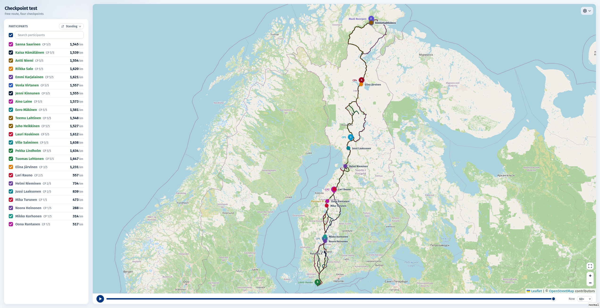

# Ride tracker page

A live-tracking page for ultra-distance rides.



## Setup

The page is plain files with no build step: put `site/` on any static host (GitHub Pages, Netlify, an S3
bucket, nginx). It gets its data from an API, described [below](#api).

1. In `site/config.js`, set `apiUrl` to where the API is served, without a trailing slash, for example
   `'https://api.example.com'`. The API has to allow the page's origin (CORS). Never put a Traccar token or
   any other secret in `config.js`: everything in `site/` is public.
2. Set `lang` to `'fi'` or `'en'` for the default language; with `null` it's English. Viewers can switch
   it, and `?lang=fi` in the address picks it.
3. Upload `site/`.

The page shows one event: `https://example.com/?event=<id>`. Add `&participant=<id>` to open one rider.

Other settings (map tiles, time zone, polling and signal thresholds) are in `config.js` too, with notes.

### Without a server

The API can be static files too, for example in the same place as the page with `apiUrl: ''`. The page
asks for `events/<id>/track?since=...`; a static host ignores the query and serves the whole track, which
the page handles. That suits a finished event, or one whose track file a script refreshes every minute.

```
site/
  events/index.html       the event list (JSON; the host serves it for /events)
  events/<id>/track       the positions (JSON, no extension)
  events/<id>/route.gpx   the route or course
```

### Preview image

For a preview image (needs Chromium):

```sh
node tools/preview-image.mjs --page https://PAGE_DOMAIN --events ../backend/events <event-id>
```

This writes `<event-id>/preview.jpg` into the event's folder. Without `--events` it writes
`previews/<event-id>.jpg`, and without an id it does every event.

## API

The page reads three GET endpoints under `apiUrl`. Any backend that serves them works.

**`/events`**: the list of events.

```json
[{
  "id": "my-ride", "start": "2026-06-06T06:00:00Z", "end": null,
  "type": "route", "title": "Coast to coast", "subtitle": null, "record": null,
  "participants": [{ "id": "alex", "name": "Alex", "color": "#e4572e" }]
}]
```

- `type` is `"route"` or `"checkpoints"`. Checkpoint events may add `cpRadiusM` and `cpRequired`.
- `title` and `subtitle` are a string or `{ "en": "...", "fi": "..." }`.
- `record` is `{ "seconds": 219960 }` or `null`.
- `color` is optional.

**`/events/<id>/track?since=<ISO time>`**: the positions, polled every minute.

```json
{
  "rideStart": "2026-06-06T06:00:00Z", "rideEnd": null,
  "participants": [{
    "id": "alex", "name": "Alex", "rideStart": "2026-06-06T06:00:00Z",
    "positions": [[1234, 1780725600000, 52.37, 4.89, 21.5, 6, 87, 0]]
  }]
}
```

- A position is `[id, timeMs, lat, lon, speedKmh, accuracyM, batteryPct, charging]`. The last two are
  optional.
- `id` must be unique per participant: the page drops duplicates by it, so returning more than asked for
  `since` is fine.
- The response also repeats the event's `type`, `title`, `subtitle` and `record`.

**`/events/<id>/route.gpx`**: the route, or for checkpoint events a course whose waypoints are the start, the
checkpoints and the finish.

## How the numbers are computed

- **Distance**: each position is snapped to the route, searching only as far ahead as the rider could have
  got, so loops and out-and-backs don't jump ahead. Positions over 300 m off the route don't count.
- **Average speed and ETA**: average speed includes stops, since that's what predicts the finish.
- **Checkpoints**: they count in order, at the first accurate enough position inside their radius. Distance
  is measured from the positions.
- **Signal gaps**: late positions are merged in. Gaps show as dashed lines, and the rider greys out after
  `staleMinutes`.
- **Current speed**: Wi-Fi and cell positions report 0, so the page shows the recent average instead,
  marked "≈".
- **Rewind**: the slider shows the ride at any moment, and ▶ plays it back.
